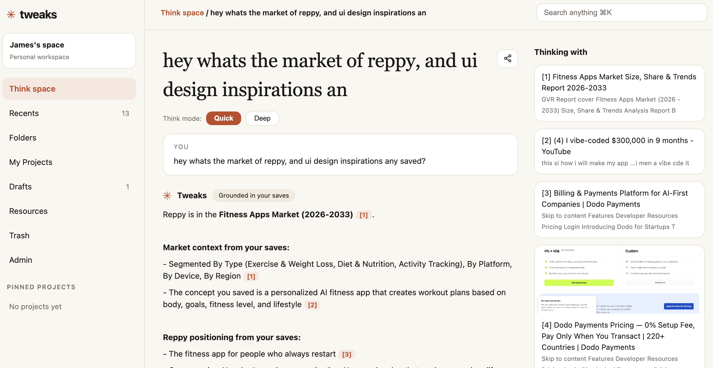
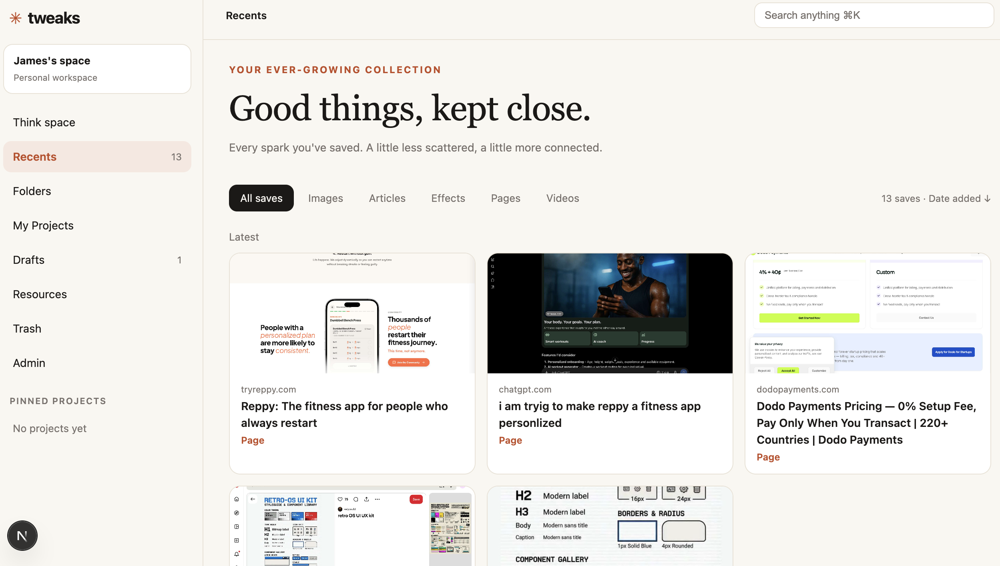
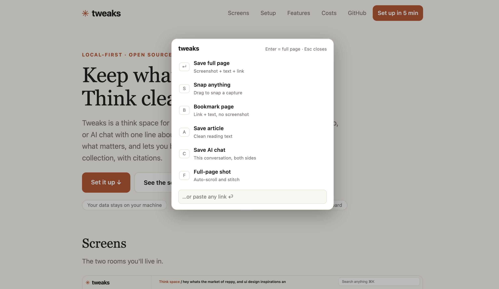

# Tweaks — a think space for what you save

Tweaks is a place to keep what moves you and think clearly with it later. You
save pages, images, articles, videos, AI chats — anything — with one line
about *why* you saved it. Tweaks files everything automatically, remembers
what matters to you, and lets you brainstorm with an AI that answers from
*your* collection, with citations back to the exact saves.

**Why it exists:** bookmarks rot, screenshots pile up, and good ideas vanish.
Tweaks turns collecting into thinking: every spark you keep becomes material
your future self can search, question, and build from.

Local-first: your data lives in a SQLite file on your machine. No accounts, no
cloud database. AI calls go to Meta's Model API when you add a key — or the
app runs on built-in fixtures so you can try everything offline.

## Screenshots

Think space — chat with your collection, citations included:



Recents — everything you've saved, filed and filterable:



Capture palette — `Alt+T` anywhere, `Enter` saves the full page:



---

## Features

**Capture (Chrome extension)**

- Save full page, Snap (drag a region), Bookmark, Image, Article, Video/Link,
  AI-chat transcript (ChatGPT, Claude, Gemini, others), full-page auto-scroll
  screenshot.
- `Alt+T` (`⌥T` on Mac) opens a capture palette — `Enter` saves the full page.
  Right-click menus, selection button, paste-a-link box.
- Smart suggestion: the popup detects articles and videos on the page and
  offers the matching save.
- Every save asks "Why are you saving this?" — on the page, right after the
  save. Your reason is what the AI files and thinks with.
- Offline queue: saves land locally first and upload when the backend is back.

**Automatic filing**

- Each save is classified into 5 sets (intent, future action, knowledge type,
  time orientation, motivation) with confidence scores, then mapped to
  deterministic meta-labels (L1/L2/L3) and a folder. You never file anything.
- Screenshots get `visual.metadata`: image count, regions, fonts, aesthetics,
  per-image descriptions and labels.
- Open taxonomy: the AI may propose new labels; duplicates fold away, new ones
  join the stats. Nothing you save falls outside the system.
- User memory: name, role, projects, interests — learned from onboarding,
  Settings, and chat ("call me James" just works).

**Think space (chat with your collection)**

- Ask questions; answers stream back grounded in your saves, with `[1] [2]`
  citation chips that link to the exact save.
- Quick mode (fast, single-shot) and Deep mode (an AI agent with tools: search
  your saves, read full saves, fetch live pages, remember facts, live web
  search with a Brave key).
- Every answer says which sources it used ("Used: memory / [1][2] / nothing
  yet") and what else you could do when nothing covers the question.
- Threads persist, can be renamed by asking, deleted singly or cleared; new
  chats can recall earlier ones. Pin saves as extra context. Save any answer
  as a draft. Share any chat with a read-only link.

**Library**

- Recents (every save with its filing, visual metadata, and actions), Folders
  (auto-shelves), Projects (references + drafts + threads around one goal),
  Drafts (editor with linked references), Resources (things you return to),
  Trash (30-day restore).
- `⌘K` search across everything — typo-tolerant ("clam interfacs" still finds
  "Calm interfaces", flagged as a close match).

**Settings & Admin**

- Settings: edit what Tweaks remembers about you; danger-zone wipe (type
  DELETE, everything personal gone, skips Trash).
- Admin: create/ban users, per-user token limits with upgrade blocking, usage
  table (calls/tokens/dollars), editable model rate card. Every AI call is
  metered.

---

## How it works

In plain words: the extension captures raw material; the web app files it with
AI and serves your dashboard; the chat agent retrieves your material and
reasons over it.

```
Chrome extension (MV3)          Next.js web app (Node 22+)
 popup / content scripts   →    API routes (token auth for the
 service worker + local         extension, localhost-only for the
 offline queue                   dashboard)
                          →    SQLite (.local/tweaks.db): saves,
                               memory, taxonomy, threads, usage
                          →    Meta Model API (Muse Spark):
                               classify + vision in parallel at
                               save time; chat + tools at ask time
```

- **At save time:** the extension uploads page text + screenshot + your reason.
  The backend scores 25 labels, derives meta-labels and a folder, extracts
  visual metadata, updates taxonomy stats — then returns "filed".
- **At ask time:** Think retrieves your matching saves (exact, then loose),
  adds your memory and thread history, and either answers directly (Quick) or
  runs a tool loop (Deep). Citations resolve per-answer, forever.
- **When AI is unreachable:** saves are kept as `needs_review`, chat falls
  back cleanly. Nothing you captured is ever lost to an AI failure.

No Supabase, no external database, no accounts server — this release is
deliberately local-only.

---

## What you need

- **Node.js 22 or newer** (`node -v` to check).
- **Google Chrome** (for the extension).
- **A Meta Model API key** — optional. Without one, everything runs in mock
  mode with fixtures so you can try the full app offline. With one, you get
  live filing and chat. Get a key at
  [dev.meta.ai](https://dev.meta.ai/docs/models).

---

## Install, step by step

**1. Get the code.** Clone the repo and enter the directory:

```sh
git clone https://github.com/nitineeen/project-tweaks.git
cd project-tweaks
```

*(Or via SSH: `git clone git@github.com:nitineeen/project-tweaks.git && cd project-tweaks`)*

**2. Run setup.** It asks a few questions and does the rest:

```sh
node setup.mjs
```

It asks for: dashboard port (default **3121**, change it if you like), the AI
base URL (default `https://api.meta.ai/v1`), your API key (blank = mock
mode), and an optional Brave search key. Then it writes
`apps/web/.env.local`, installs dependencies, checks your key against the
gateway's `/models` list, creates the SQLite database, and prints your
extension token. For scripted installs: `node setup.mjs --yes` takes
`SETUP_PORT`, `SETUP_BASE`, `SETUP_KEY`, `SETUP_SEARCH` from the environment
(or defaults) and never overwrites an existing `.env.local`.

**3. Start the dashboard:**

```sh
cd apps/web && npm run dev
```

Open the Think space at `http://localhost:3121/think` (your port if you
changed it).

**4. Load the extension.** Open `chrome://extensions`, turn on Developer
mode, "Load unpacked", and pick the `apps/extension` folder. Pin Tweaks to
the toolbar.

**5. Link the extension.** Open the Tweaks popup → Connection → paste the API
URL (`http://localhost:3121`) and the token setup printed. Queued saves
upload immediately.

**6. Save your first spark.** Press `Alt+T` on any page (`⌥T` on Mac),
`Enter` for the full page, tell it why you're saving it. Then ask about it
in Think space.

### Port

Default is **3121**. Change it any time: re-run `node setup.mjs` and enter a
new port (it rewrites the dev scripts and the extension's default URL), or
hand-edit the `-p` flag in `apps/web/package.json` (`dev` and `start`
scripts) plus the API URL in the extension popup.

### Mock vs real

- **Mock** (blank key): deterministic fixtures everywhere, labeled
  "(mock read)". Filing, chat, tools, and memory all work — with sample
  intelligence, not real AI. Perfect for trying the app and for tests.
- **Real** (key + `AI_PROVIDER=real`, set automatically by setup): live Muse
  Spark filing, vision, and chat. Usage is metered per user in Admin.

---

## API reference

Two surfaces. The **extension API** takes `Authorization: Bearer
<DEV_EXTENSION_TOKEN>`. The **dashboard API** only answers localhost (no
token; it's your own machine's UI).

### Extension API

| Method & path | What it does |
|---|---|
| `POST /api/saves` | Save: multipart `metadata` JSON + `screenshot` file → filed row |
| `GET /api/saves` | List saves (`?limit ?type ?project`) |
| `GET /api/saves/[id]/status` | Filing status of one save |
| `POST /api/think` | Token-authed chat answer (`?stream=1` for SSE) |

`POST /api/saves` metadata: `original_url` (required), `page_title`,
`extracted_text`, `ocr_text`, `user_reason`, `tz`, `save_type`
(page/region/image/article/video/link/chat), `selection`, `image_url`.

### Dashboard API (localhost only)

| Method & path | What it does |
|---|---|
| `POST /api/dash/think` | Chat (SSE: refs, tokens, tool status, done). Body: `query`, `conversationId?`, `pinIds?`, `mode` (quick/deep) |
| `GET /api/dash/search?q=` | ⌘K results across saves, projects, drafts (typo-tolerant) |
| `GET /api/dash/drafts` | List drafts |
| `POST /api/dash/drafts` | New draft: `{conversationId}` (from last answer) or `{title}` |
| `PUT /api/dash/drafts` | Edit draft: `{id, title, body}` |
| `GET /api/dash/projects` | List projects |
| `POST /api/dash/projects` | Create project: `{name, intention?}` |
| `PUT /api/dash/saves/[id]` | Save ops: `{op: trash\|restore\|resource\|unresource\|project, value?}` |
| `GET /api/dash/shot/[id]` | Screenshot bytes for a save |
| `POST /api/dash/share` | Share link for a chat: `{conversationId}` → `/share/[token]` |
| `DELETE /api/dash/conversations` | Delete thread `{id}` or all `{all:true}` |
| `DELETE /api/dash/trash` | Empty trash permanently |
| `PUT /api/dash/memory` | Set memory: `{layer, key, value}` (layers: permanent, occupational, dynamic, temporary) |
| `DELETE /api/dash/wipe` | Danger-zone wipe: `{confirm:"DELETE"}` |
| `GET /api/dash/admin/users` | List users + usage |
| `POST /api/dash/admin/users` | Create user: `{email, name?}` |
| `PUT /api/dash/admin/users/[id]` | `{status: active\|banned}` and/or `{token_limit}` |
| `GET /api/dash/admin/rates` | Rate card |
| `PUT /api/dash/admin/rates` | Edit rate: `{model, per_1m_in?, per_1m_out?, per_unit?, unit?}` |

---

## Environment reference

Everything lives in `apps/web/.env.local` (created by setup; never commit
it — `.gitignore` excludes it). Model IDs are versioned on purpose: bare
names like `muse-spark` return 404 from the gateway.

| Variable | Default | Meaning |
|---|---|---|
| `AI_PROVIDER` | `mock` | `mock` fixtures, or `real` gateway calls |
| `DB_PROVIDER` | `sqlite` | Local SQLite (only backend in this release) |
| `AUTH_MODE` | `dev-token` | Single local space, extension-token auth |
| `SQLITE_PATH` | `./.local/tweaks.db` | Database file (auto-created) |
| `DEV_EXTENSION_TOKEN` | generated | Paste into the extension popup |
| `AI_API_BASE` | `https://api.meta.ai/v1` | Model gateway base URL |
| `AI_API_KEY` | blank | Gateway key (blank = mock mode) |
| `MODEL_CLASSIFY` | `muse-spark-1.3` | 25-label scoring at save time |
| `MODEL_VISION` | `muse-spark-1.3` | Screenshot visual.metadata |
| `MODEL_THINK_QUICK` | `muse-spark-1.1` | Fast chat answers |
| `MODEL_THINK_DEEP` | `muse-spark-1.3` | Tool-loop chat answers |
| `MODEL_SEGMENT` | `sam-3.1` | Layout segmentation (reserved) |
| `MODEL_RERANK` | `muse-spark-1.3` | Query rewrite + re-rank (reserved) |
| `MODEL_IMAGE` | `muse-image-1.0` | Image generation (reserved) |
| `MODEL_TRANSCRIBE` | `muse-voice-transcribe-1.0` | Speech-to-text (reserved) |
| `MODEL_EMBED` | `open-weights-local` | Local embeddings path (reserved) |
| `MODEL_LOCAL` | `muse-spark-open` | Offline open-weights pass (reserved) |
| `SEARCH_API_KEY` | blank | Brave key → live web_search tool in Deep |

---

## What AI calls cost

Billed by Meta per use (verify current numbers on Meta's pricing page).
Tweaks meters every call into Admin automatically:

| Model | Price |
|---|---|
| Muse Spark 1.3 / 1.2 | $1.25 / $4.25 per 1M in/out tokens |
| Spark Contributor mode | $0.10 / $0.20 per 1M in/out tokens |
| Muse Image 1.0 | $0.01 per image |
| Voice Transcribe | $0.18 per audio hour |
| SAM 3.1 | $2.50 per 1,000 images |

Mock mode costs nothing. A typical save (classify + vision) is a fraction of
a cent; chats cost a few cents per long thread at most.

---

## Project layout

```
tweaks/
  setup.mjs            one-command installer (this file's step 2)
  README.md            this file
  LICENSE            MIT
  docs/                screenshots for the README
  apps/web/            Next.js dashboard + API + SQLite
    app/               pages (think, recents, folders, projects, drafts,
                       resources, trash, settings, admin, share) + api routes
    src/lib/           db, think agent, tools, classify, ai, enrich, fuzzy…
    .env.local         your keys (created by setup, never committed)
    .local/            your database + screenshots (never committed)
  apps/extension/      Chrome extension (MV3): popup, content scripts,
                       service worker with offline queue
  packages/shared/     taxonomy seeds, prompts, schemas, meta-label +
                       memory + visual helpers shared by web app
```

---

## Troubleshooting

- **Port busy (`EADDRINUSE`).** Something else runs there — re-run
  `node setup.mjs` and pick another port, or stop the other process.
- **401 Site can't be reached / invalid key.** Check `AI_API_KEY` in
  `apps/web/.env.local`, restart `npm run dev`.
- **404 `model_not_found`.** Use versioned IDs (`muse-spark-1.3`, not
  `muse-spark`). Setup writes correct ones.
- **Save stuck on "finishing…".** The backend isn't running — the save is
  queued locally and uploads when you start `npm run dev`.
- **Reason card never pops.** Reload the extension at `chrome://extensions`
  (⟳) and refresh the tab. `chrome://` pages can't show popups — the reason
  box inside the extension popup covers those.
- **Palette/shortcut dead.** `Alt+T` (`⌥T` on Mac) — Chrome reserves
  Ctrl+T/⌘T, so Tweaks can't use them. Remap at
  `chrome://extensions/shortcuts`.
- **Weird build errors (`./611.js`, `/_not-found`).** Stale cache:
  `rm -rf apps/web/.next` and retry.
- **Extension menus missing.** Reload the extension — new menus need a
  reload to register.

## Landing page

The `landing/` folder is a zero-dependency static page (same UI, setup guide
with copy buttons, screenshots) made to deploy on Vercel:

```sh
cd landing && npx vercel
```

Or in the Vercel dashboard: Import the repo → set **Root Directory** to
`landing` (or leave default, handled by `vercel.json`) → Deploy. No build step, no env vars needed.

## Developing

```sh
cd apps/web
npm test        # focused suites, no network, no deps beyond node
npx next build  # production check (then rm -rf .next to keep dev clean)
```

Tests live next to the code (`src/lib/*.test.js`, run with `node --test`).

## License

MIT — see [LICENSE](LICENSE). Your saves, keys, and database stay yours;
nothing here phones home except the AI gateway calls you configure.
